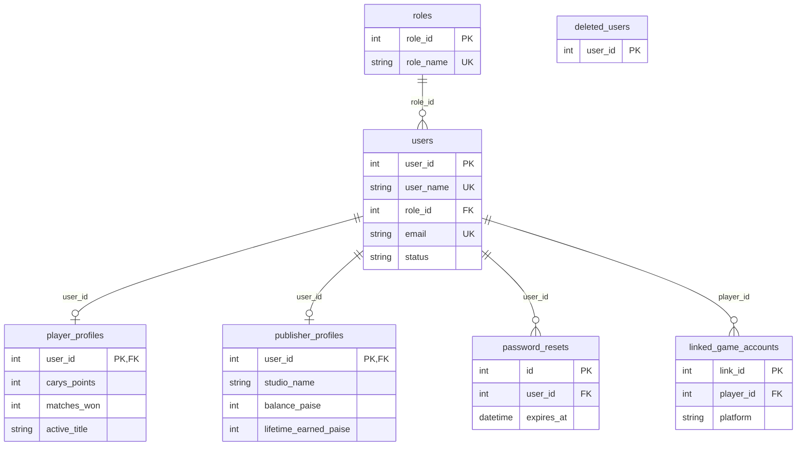
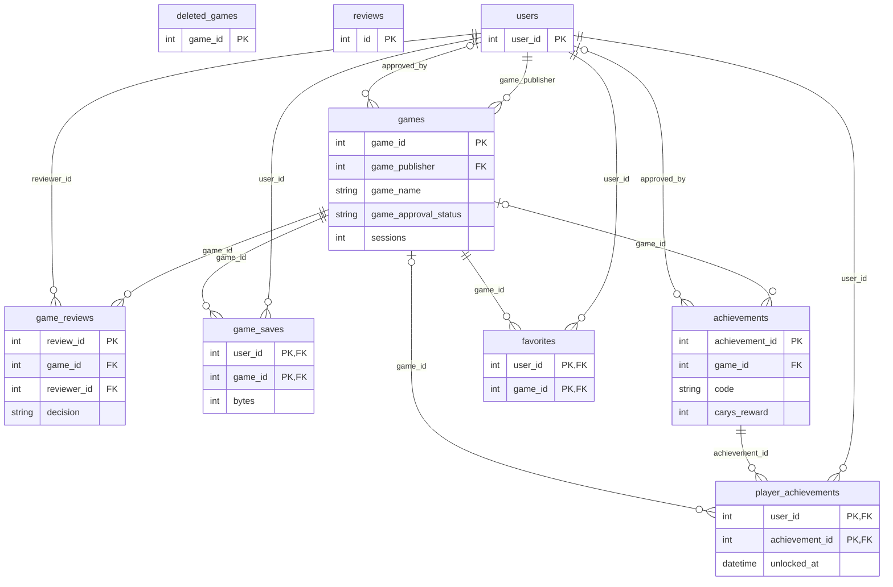
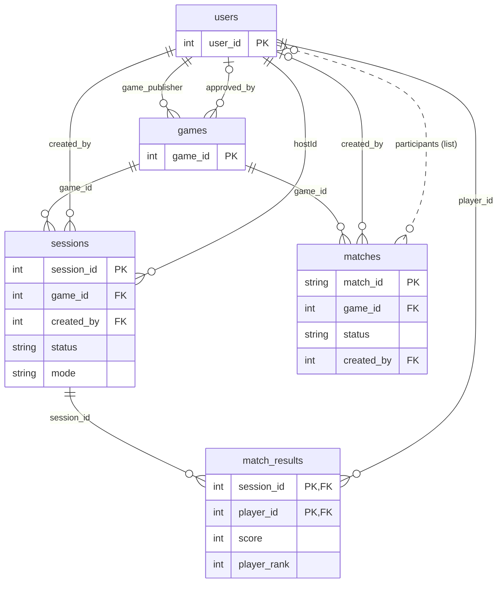
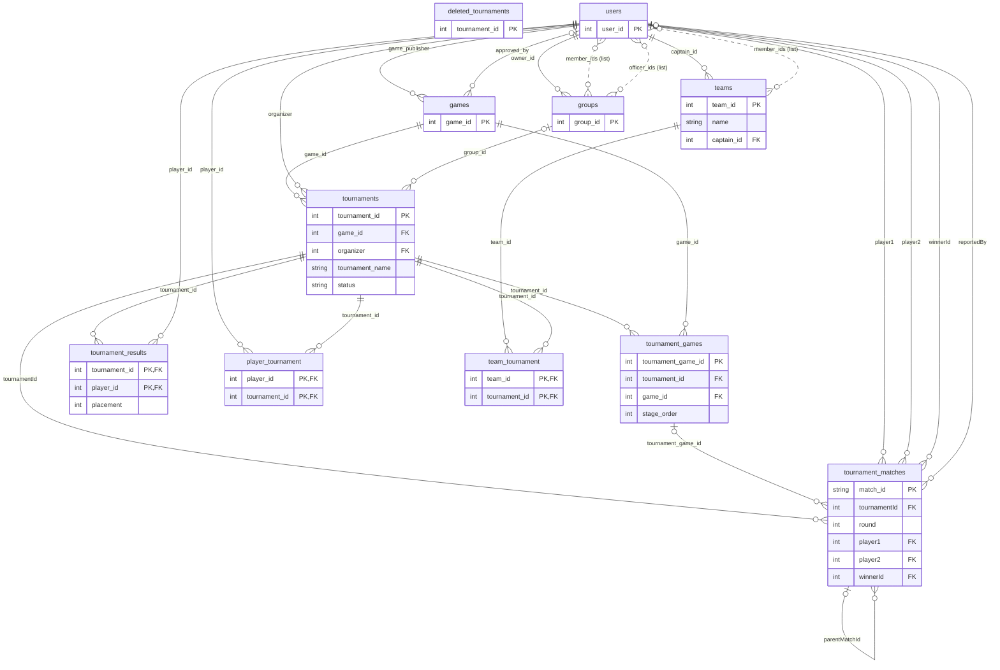
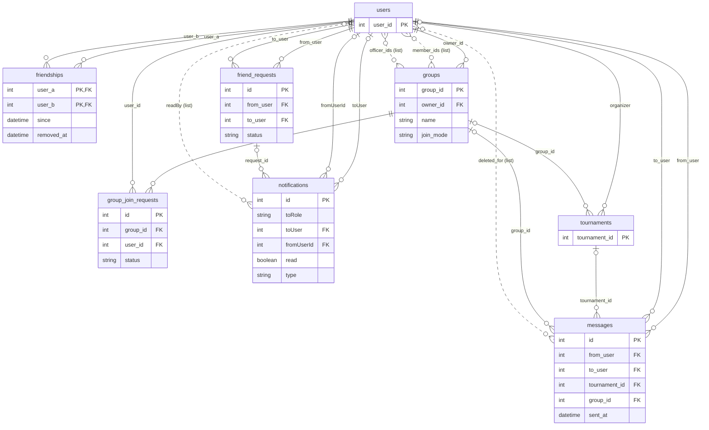
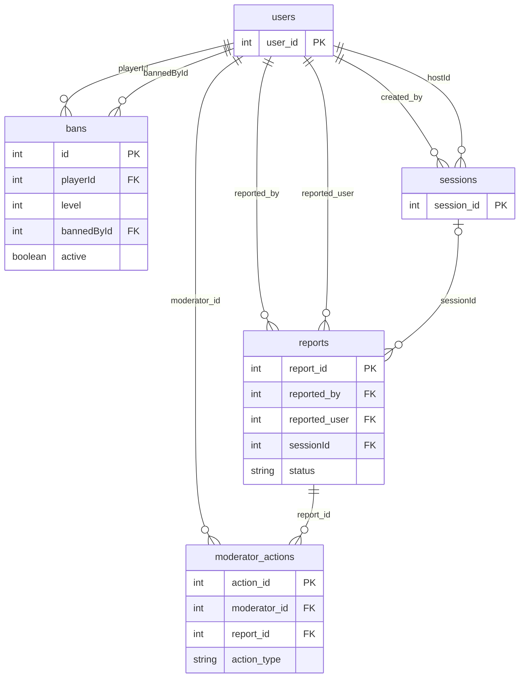
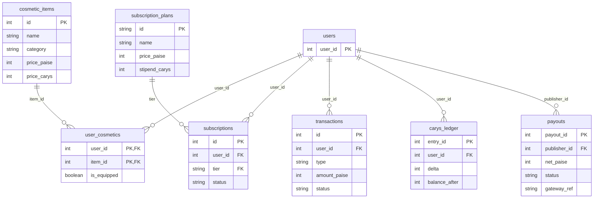

# PlayCarys ER diagrams

Drawn from the tables the back-end actually runs on (`root/back-end/src/data/store.ts`, 43 tables). GitHub draws the Mermaid blocks below automatically.

**How to read them.** Solid line = a real foreign key. Dashed line = a relationship stored as a JSON list of ids in one column, so the database cannot enforce it. `PK` primary key, `FK` foreign key, `UK` unique. Each diagram shows the key columns only; the full column list for every table is in `PlayCarys_DBschema.sql`. Tables from another domain appear with just their primary key so you can see what a link points at.

The whole-database picture is `PlayCarys_ER.png`.

## Accounts

Who people are: roles, users, the two profile types, password resets and linked game accounts.

Tables: `roles`, `users`, `player_profiles`, `publisher_profiles`, `password_resets`, `linked_game_accounts`, `deleted_users`

## Games

The catalogue: games, their reviews and saves, achievements and what players have unlocked.

Tables: `games`, `game_reviews`, `game_saves`, `achievements`, `player_achievements`, `deleted_games`, `favorites`, `reviews`

## Play

Sessions players start, the matches inside them, and each player's result.

Tables: `sessions`, `matches`, `match_results`

## Tournaments

Tournaments, their stages and brackets, who entered, and the results.

Tables: `tournaments`, `tournament_games`, `tournament_matches`, `tournament_results`, `player_tournament`, `team_tournament`, `teams`, `deleted_tournaments`

## Social

Friends, friend requests, chat, groups and notifications.

Tables: `friendships`, `friend_requests`, `messages`, `groups`, `group_join_requests`, `notifications`

## Moderation

Reports, the moderator actions taken on them, and bans.

Tables: `reports`, `moderator_actions`, `bans`

## Economy

Shop items, subscriptions, the Carys ledger, payments and publisher payouts.

Tables: `cosmetic_items`, `user_cosmetics`, `subscription_plans`, `subscriptions`, `transactions`, `carys_ledger`, `payouts`

## Platform and tombstones

`platform_flags` holds one-off platform switches and has no links to other tables. The three `deleted_*` tables are tombstone lists: they exist so a browser that still holds an old copy of the data cannot bring a deleted account, game or tournament back. `favorites` and `reviews` are unused legacy tables.
